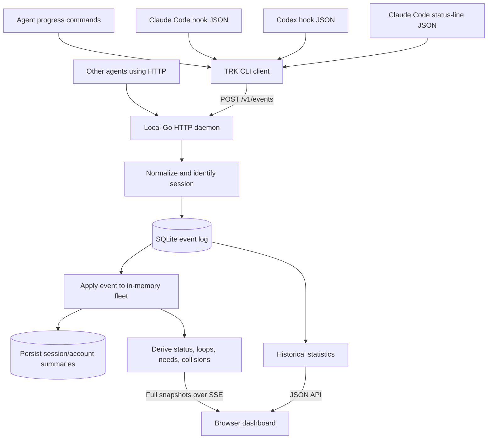

# TRK: what it does and how it works

This guide describes the implementation in this checkout. Start with [README.md](README.md) for everyday usage; use this document to understand the code and data flow. The [Codex support plan](docs/codex-support-plan.md) records the implemented integration, validation, and follow-up milestones.

## 1. What the project is

TRK is a local dashboard for coding-agent sessions. It answers: what is each agent trying to do, what is it actually doing, how much context has it used, and does it need a person?

The core idea is to compare two independent signals:

- **Declared intent:** an agent runs `trk start`, `step`, `progress`, `blocked`, or `done` to describe its task.
- **Observed activity:** Claude Code and Codex hooks report tools, prompts, permission requests, and turn endings. Claude's status line also supplies context, token, cost, and account-usage readings when available.

For example, a card can say “writing tests, step 3/5” while its activity shows that the same command has failed five times. TRK detects that repetition using rules; it does not ask another model to analyze the agent.

Claude Code and Codex have built-in hook adapters. TRK observes external sessions and can launch managed Claude or Codex terminals from the dashboard. Other agents can submit JSON to the HTTP API. Unknown usage values remain distinct from measured zero values.

## 2. One executable, several jobs

The project is written in Go. The executable starts at [`cmd/trk/main.go`](cmd/trk/main.go), which delegates to [`internal/cli/cli.go`](internal/cli/cli.go).

| Command | Job |
|---|---|
| `trk serve` | Run the local HTTP service, storage, and dashboard. |
| `trk open` | Start or resume the service and open the dashboard. |
| `trk stop` | Set a persistent pause flag and stop the service. |
| `trk init` | Install Claude Code integration into its configuration. |
| `trk init --agent codex` | Merge Codex hooks; optionally add instructions with `--agents-md`. |
| `trk codex-hook` | Forward Codex JSON using native session identity. |
| `trk codex start/step/progress/blocked/done` | Submit declared Codex progress. |
| `trk hook` | Read hook JSON from standard input and forward it. |
| `trk statusline` | Forward status JSON and print a compact status line, or run an existing status command. |
| `trk start/step/progress/blocked/done` | Submit declared progress. |
| `trk update` | Check for or install a release and restart the daemon. |

The frontend is HTML, CSS, and vanilla JavaScript embedded through `go:embed` in [`web/embed.go`](web/embed.go). There is no frontend compilation step. SQLite uses the pure-Go `modernc.org/sqlite` driver, so release builds disable CGO.

## 3. The complete data path



A typical event takes these steps:

1. The CLI creates a `model.Envelope`, containing source, kind, timestamp, payload, and any available session/process identity.
2. [`internal/client/client.go`](internal/client/client.go) posts it to `/v1/events`. If the local daemon is absent, it can start another copy of the executable as `trk serve`.
3. [`Fleet.Normalize`](internal/fleet/fleet.go) selects the event kind and session, adjusts unreasonable timestamps, trims large payloads, and suppresses unchanged status-line readings.
4. The daemon appends the normalized event to SQLite. If this fails, ingestion returns an error before applying the event.
5. `Fleet.Apply` updates the session and its recent activity tracker. The daemon saves the session summary and, for status events, the account snapshot.
6. The daemon marks the dashboard as changed. Its update loop eventually broadcasts a fresh fleet snapshot.

This is a small event-log architecture: raw events support history, while summaries and working memory make live views cheap. The event append and summary updates are separate database operations, rather than one transaction.

## 4. How events find the correct agent

Attribution lives in [`internal/fleet/fleet.go`](internal/fleet/fleet.go). The legacy Claude path tries, in order:

1. A native session ID inside a hook or status-line payload.
2. An explicit envelope session ID, including `TRK_SESSION`.
3. A previously learned Claude process ID to session mapping.
4. A working-directory match against known sessions, preferring an exact directory, matching branch, and recent activity.
5. A synthetic ID derived from the directory, or `unknown` if no directory is available.

[`internal/ptree`](internal/ptree) walks ancestors to locate Claude, with platform-specific implementations. This lets a `trk step` command launched by Claude connect to the session learned from its hooks.

Directory attribution is a fallback: multiple agents in the same folder can be ambiguous. Stable explicit IDs are preferable for third-party integrations.

Codex uses a separate path: native hook IDs become `codex:<native-id>` internally, with the original ID stored separately. Its shared daemon can serve several sessions, so PID attribution is deliberately unused. Declared commands use `TRK_SESSION`, then `CODEX_THREAD_ID` when available. Without either, only one unambiguous active Codex directory match is accepted; otherwise a separate directory fallback is created. Claude's directory matching excludes Codex sessions.

The desktop also creates short-lived forks to suggest the user's next message. `internal/codex/background.go` recognizes their specific prompt preamble. These are filtered from fleet cards, totals, timeline, directory attribution, and statistics while retaining stored history. The filter uses the persisted prompt so it also covers existing cards after restart. It does not merge distinct chats sharing a directory or suppress ordinary user forks.

[`internal/codex/hook.go`](internal/codex/hook.go) normalizes Codex events before storage. Turn-scoped tool IDs prevent cross-turn pairing, and stable tool-stage keys suppress duplicate delivery through a database uniqueness constraint. Patch headers supply every touched file. Structured errors and recognizable shell exit metadata mark failures; unfamiliar results remain unknown. The adapter ignores unverified usage/quota fields and does not parse transcripts.

[`internal/gitinfo/gitinfo.go`](internal/gitinfo/gitinfo.go) reads `.git` metadata directly to identify the repository and branch, including worktree indirection. It does not invoke the Git executable. Fleet caches these lookups for 30 seconds.

## 5. How live status is calculated

[`internal/derive`](internal/derive) contains the rule-based calculations. [`Tracker`](internal/derive/tracker.go) keeps recent tool calls, waiting periods, completion time, activity time, and the last declared progress update.

Status uses this precedence:

| Priority | Status | Trigger |
|---|---|---|
| 1 | `waiting` | An unresolved permission request or question. |
| 2 | `blocked` | The agent explicitly reported a blocker. |
| 3 | `interrupted` | An interruption is newer than completion and subsequent activity. |
| 4 | `done` | A task/turn/session ended and no later activity supersedes it. |
| 5 | `idle` | More than two minutes without activity. |
| 6 | `looping` | A repetition rule matches. |
| 7 | `working` | None of the above. |

`done` can mean that a Claude turn ended; it does not prove that the overall assignment succeeded. Status-line refreshes do not count as work, so they cannot keep an inactive agent looking busy.

Loop detection examines the last ten minutes. It flags the same normalized tool/input failing at least five times, or one file edited at least eight times since the last declared progress update. A loop explanation can still appear when a higher-priority status wins.

Tool starts and completions are paired by `tool_use_id`. Timestamp checks accommodate common asynchronous ordering problems, such as a completion arriving before its start or a permission event arriving after its resolution. The tracker prunes old tool history when events are applied, using a 30-minute retention window.

### Context and collision warnings

Context advice comes from reported percentages: yellow at 40%, a handoff/compaction hint at 50%, red at 60%, and an additional re-grounding hint at 70%. Missing context remains unknown. TRK does not compact sessions itself.

A collision means two or more visible sessions, excluding done/interrupted sessions, touched the same normalized file path within ten minutes, with at least one edit. This is a warning about overlapping activity, not a filesystem lock or proof of a merge conflict. File detection depends on recognized tool payloads; arbitrary shell commands do not automatically become file touches.

## 6. Storage and restart behavior

[`internal/store/store.go`](internal/store/store.go) owns SQLite migrations and persistence. The database uses WAL mode, a five-second busy timeout, and one open connection.

| Table | Purpose |
|---|---|
| `events` | Timestamped normalized events and their JSON payloads. |
| `sessions` | Latest task, progress, context, counters, title, and dismissal data. |
| `account` | One latest Claude plan-usage snapshot. |
| `settings` | Shared settings such as terminal enablement and auto-hide interval. |
| `claude_pids` | Learned process/session mappings. |

On startup, [`internal/daemon/run.go`](internal/daemon/run.go) restores summaries, account data, settings, and process mappings seen within the last day. It then replays the last 30 minutes of events to reconstruct recent tracking state. Some cumulative data has explicit protection against being counted again during replay.

The data directory also contains `trk.pid`, `trk.log`, and, while stopped, a `paused` file. Normal startup binds the port before opening storage, making the listener the single-instance guard.

The default database cap is 5,120 MiB. A maintenance loop checks at startup and hourly; when allocated used pages exceed the cap, it removes oldest events toward 90% of the cap. It preserves session/account summaries. Freed pages are reusable, so deletion does not necessarily shrink the database file on disk. Historical charts lose detail when their underlying events are removed.

Payloads larger than 16 KiB undergo recursive string/array trimming. This reduces storage use; it is not secret redaction or a guaranteed hard 16 KiB output limit.

## 7. How the browser stays live

[`internal/daemon/server.go`](internal/daemon/server.go) serves the API and embedded assets. [`internal/daemon/hub.go`](internal/daemon/hub.go) distributes full snapshots to connected browsers.

- `GET /v1/stream` uses Server-Sent Events, with an initial snapshot and 15-second keepalive comments.
- Changes are combined into at most four broadcasts per second.
- A five-second refresh advances time-dependent statuses even when no new event arrives.
- Each browser gets one pending snapshot slot. New snapshots replace stale pending ones, preventing slow viewers from blocking ingestion.
- Browser `EventSource` handles reconnection. Full snapshots mean the client does not need to replay every intermediate change.

The main frontend files are:

| File | Responsibility |
|---|---|
| [`web/app.js`](web/app.js) | Fleet cards, status display, live updates, and layout preferences. |
| [`web/editor.js`](web/editor.js) | Card-layout settings UI. |
| [`web/agents.js`](web/agents.js) | Agent drawer, rename, launch, resume, and fork actions. |
| [`web/term.js`](web/term.js) | Terminal viewer and input/resize transport. |
| [`web/limits.js`](web/limits.js) | Usage history charts and pace projections. |
| [`web/codex-limits.js`](web/codex-limits.js) | Codex quota snapshots, reset times, and freshness above the Claude charts. |
| [`web/stats.js`](web/stats.js) | Historical charts, filters, and tables. |

Layout, terminal font size, and similar preferences use browser `localStorage`. Titles, terminal enablement, and auto-hide settings are saved by the daemon and shared across browsers. Idle/done cards auto-hide after five hours by default; dismissing a card hides it until new activity rather than deleting history.

## 8. Where statistics and limits come from

The Stats page requests `/v1/stats`; it refreshes about once per minute. [`internal/daemon/stats.go`](internal/daemon/stats.go) reads relevant rows, applies date/repository/provider filters, and caches a computed result for 30 seconds. The endpoint accepts 1–90 days; the UI offers common shorter ranges. Cost, token, and model-time presence flags distinguish unknown readings from measured zero; incomplete totals are labeled partial.

[`internal/stats/stats.go`](internal/stats/stats.go) calculates daily spend, tokens, tool failures, command latency, file touches, context peaks, activity heatmaps, and waiting times. Spend/token/model-time totals use increases between cumulative status readings, rather than summing those readings. Tool durations pair start/end events. Agent hours estimate activity in five-minute buckets; individual tool/wait contributions to time totals are capped at one hour.

These are observations and estimates, not a complete billing or timekeeping ledger. Missing events, late events, trimming, and absent status fields affect the results. The fleet header's `tokens_today` is a simpler sum of cumulative tokens for visible sessions updated today, so it is not the same calculation as the Stats page's daily token deltas.

The Limits page reads account usage from status-line payloads and obtains history from `/v1/limits/history?window=5h` or `7d`. It projects the observed usage rate toward reset, using either a whole-window or recent rate. It does not query an account billing API or enforce a quota. Reset timestamps from Claude are converted from seconds to internal milliseconds.

The Codex section uses a separate `/v1/codex/limits` endpoint. `internal/codex/limits.go` starts an owned stdio App Server, initializes its protocol, calls `account/rateLimits/read`, and ends only that helper process. It uses the existing CLI sign-in without reading credentials itself or starting a conversation. The endpoint shares a one-minute cache across viewers, retries failures after 15 seconds, caps each read at 12 seconds independently of browser disconnects, retains old readings as stale on failure, and exposes only typed quota fields. Windows helpers run hidden. Actual window lengths and multi-bucket responses are preserved; missing windows are not treated as zero. Codex snapshots stay in memory and do not enter Claude's account/history or session statistics.

## 9. Optional terminals actually run agents

When enabled, the dashboard can start Claude or Codex processes in a chosen absolute directory. [`internal/term/term.go`](internal/term/term.go) starts the executable with an argument array, connects it to a pseudo-terminal, and maintains up to 256 KiB of in-memory scrollback per terminal. It limits running terminals to 16.

The browser uses a separate WebSocket endpoint for terminal output, keystrokes, and resize messages. SSE remains responsible for fleet state.

Resuming uses `claude --resume <id>`; forking adds `--fork-session`. The daemon checks known live processes before resuming a conversation that may already be running. It links terminal processes to hook-reported sessions using the process tree.

Closing the drawer only detaches its viewer. Stopping, restarting, or updating the daemon ends its owned agents. Scrollback is memory-only; conversation persistence and later resume are the selected agent's responsibility.

Windows 10/11 uses ConPTY through github.com/UserExistsError/conpty v0.1.4. Arguments are escaped for CreateProcess without a command shell; native executables are required. WSL uses the Unix PTY implementation. Codex runs with --no-daemon; TRK_TERMINAL_ID is forwarded by its hook executable to associate the root conversation with its owned terminal. Later subagent IDs cannot overwrite that association. Parent conversation identity is removed from the child environment. Resume keys are provider-namespaced and duplicate managed resumes are rejected.

## 10. Integration, failure behavior, and local boundaries

`trk init` edits Claude settings and a marked `CLAUDE.md` block through [`internal/claudecfg`](internal/claudecfg). It merges asynchronous hooks, offers to chain an existing status line, backs up existing files, and avoids duplicating its entries. `--dry-run` previews changes. `CLAUDE_CONFIG_DIR` and `--claude-md` allow alternate destinations.

`trk init --agent codex` uses [`internal/codexcfg`](internal/codexcfg) to validate all planned edits, merge owned hook commands, back up existing files, and atomically replace each changed file. It respects `CODEX_HOME`, supports dry runs, and edits a marked `AGENTS.md` block only with an explicit path. On Windows, an encoded PowerShell wrapper quotes the executable and forwards UTF-8 stdin. Codex's own `/hooks` trust step remains necessary. Multi-file writes are individually atomic, not one transaction.

Reporting commands are wrapped to return exit code zero, even after a panic. HTTP requests normally have a 200 ms timeout. A call that must start the daemon additionally enters a roughly one-second retry loop; an existing chained status command runs on its own schedule. Consequently, 200 ms is a request timeout, not a strict total wall-clock guarantee for every invocation. Reporting is best-effort and has no durable client retry queue.

`trk stop` persists the pause flag so subsequent local hooks neither submit events nor respawn the daemon. `trk open`, `serve`, and a successful non-dry initialization clear that pause. `TRK_URL` selects an explicit server and disables automatic local spawning; local pause handling is tied to the default local-server mode.

The CLI serves on `127.0.0.1`. The HTTP guard accepts only localhost hostnames/IPs in `Host` and, when provided, `Origin`. It does not authenticate local processes and does not require an exact same port in the Origin. Treat the daemon as a local service, not a multi-user network server.

Stored events may include prompts, commands, paths, and file snippets. There is no application-level encryption/redaction layer. Normal tracking stays local, but explicit updates download releases from GitHub, and `trk open` can check for updates once a day unless `TRK_NO_UPDATE_CHECK` is set. A configured `TRK_URL` can also direct reports elsewhere.

## 11. API and extension points

| Endpoint | Purpose |
|---|---|
| `POST /v1/events` | Ingest a reporting envelope. |
| `GET /v1/sessions` | Complete dashboard view. |
| `GET /v1/sessions/{id}` | One session and its latest 200 stored events. |
| `POST /v1/sessions/{id}/title` | Set/reset a card title. |
| `POST /v1/sessions/{id}/dismiss` | Hide an idle/done card. |
| `POST /v1/settings` | Change shared settings. |
| `GET /v1/account` | Latest account usage. |
| `GET /v1/limits/history` | Bucketed usage history. |
| `GET /v1/codex/limits` | Cached Codex account quota snapshot, error/freshness state. |
| `GET /v1/stats` | Historical analytics. |
| `GET /v1/stream` | Live SSE snapshots. |
| `GET/POST /v1/terms` | List/start terminal agents. |
| `DELETE /v1/terms/{id}` | Stop/remove a terminal. |
| `GET /v1/terms/{id}/ws` | Attach a terminal viewer. |
| `POST /v1/shutdown` | Shut down without persisting a pause. |
| `POST /v1/stop` | Pause and stop. |
| `GET /healthz` | Health and binary version. |

For another agent, a basic progress event already works:

```json
{
  "source": "api",
  "kind": "step",
  "session_id": "my-agent-123",
  "payload": {
    "text": "Writing tests",
    "cwd": "C:/projects/example"
  }
}
```

This supplies declared progress only. Automatic context readings, tool interpretation, process discovery, and terminal actions require provider-specific work.

## 12. Finding your way around the source

| Directory | What to look for |
|---|---|
| `cmd/trk` | Executable entry point. |
| `internal/cli`, `internal/client`, `internal/config` | Commands, HTTP submission, lifecycle, environment settings. |
| `internal/model` | Shared wire/storage data types. |
| `internal/daemon` | HTTP routes, startup/recovery, SSE, statistics, terminal integration. |
| `internal/fleet` | Event normalization, attribution, session updates, dashboard views/widgets. |
| `internal/derive` | Tool descriptions, status, loops, collisions, context advice. |
| `internal/store`, `internal/stats` | SQLite and historical computation. |
| `internal/ptree`, `internal/gitinfo` | Local process and repository inspection. |
| `internal/claudecfg` | Claude configuration parsing, merging, backups, and marked instructions. |
| `internal/codex`, `internal/codexcfg` | Codex hook normalization and opt-in configuration installation. |
| `internal/term` | Agent process ownership, PTY, scrollback. |
| `internal/update`, `internal/version` | Release checking/replacement and build version. |
| `web` | Embedded UI, fonts, and vendored browser assets. |
| `e2e` | Tagged acceptance tests. |

For a first reading, follow `main.go` → `cli.Run` → `report/envelope` → `Client.Send` → `postEvent` → `Fleet.Normalize/Apply` → `Fleet.View` → `app.js`.

## 13. Building and checking changes

The checked-in `go.mod` specifies **Go 1.27.1**. Direct Go commands work without the Unix-oriented Makefile:

```sh
go build -o bin/trk ./cmd/trk
go test ./...
go vet ./...
```

On Windows, use `-o bin/trk.exe` for the build. The Makefile's `make demo` builds a separate development service on port 17777, seeds fake events, and uses `/tmp/trk-dev`. Those targets assume Unix shell utilities; use WSL or adapt commands on native PowerShell.

CI runs vet and race tests on Linux, macOS, and Windows, plus tagged E2E tests on Linux/macOS. GoReleaser produces Linux/macOS/Windows binaries for amd64 and arm64 and publishes checksum files. The updater verifies a downloaded archive's SHA-256 against the release checksum before replacing the executable.

Changing embedded web files requires rebuilding and restarting the daemon. [`TRK_SPEC.md`](TRK_SPEC.md) and [`docs/plan.md`](docs/plan.md) are design/history documents; where they differ from the running implementation, read the source. For example, optional agent terminals extend the original observe-only scope.

The revised integration has been checked with Go tests, vet, a Windows build, JavaScript syntax checks, and an isolated native Windows hook/daemon smoke test. See the plan's validation record for coverage and remaining platform checks.
